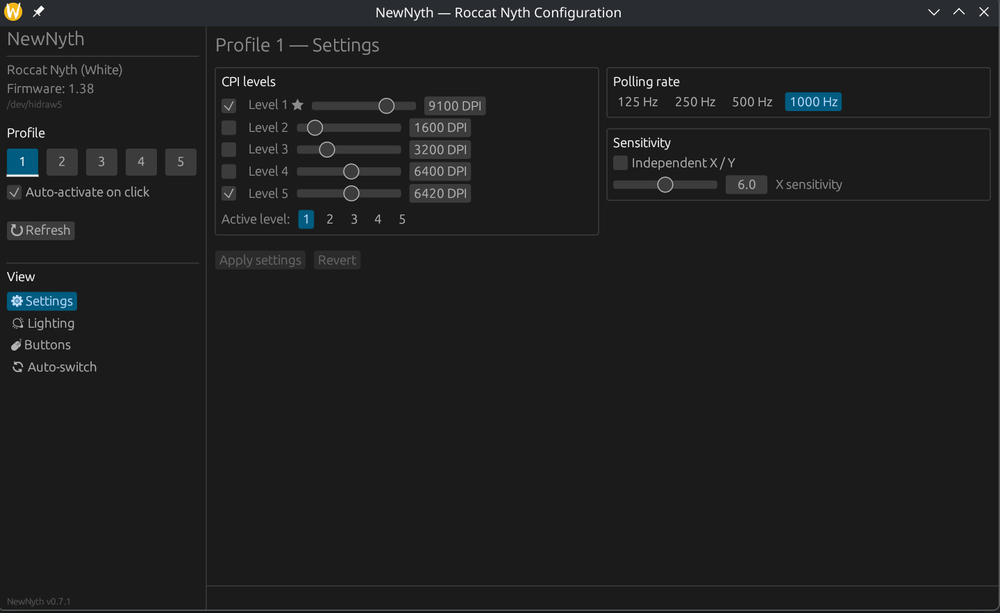
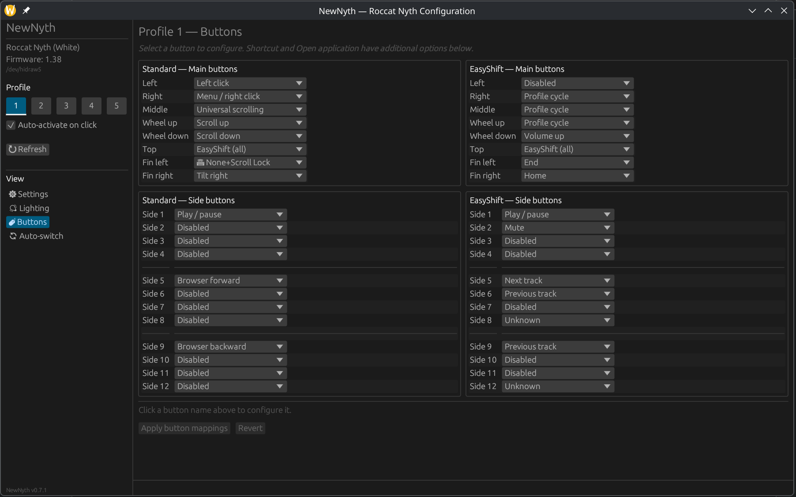
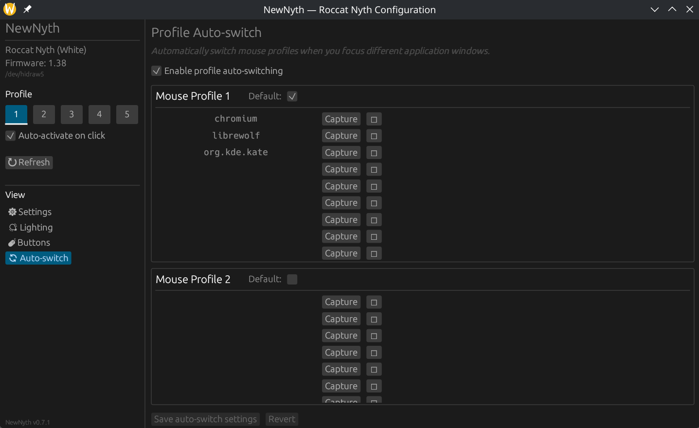
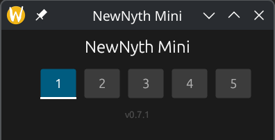

# NewNyth

**Modern Linux driver and configuration tools for the Roccat Nyth gaming mouse**, rewritten in (everybody's favourite) Rust.

[](https://github.com/LunaBaloona/NewNyth/actions/workflows/build.yml)
[](LICENSE)

Ported from the original [roccat-tools](https://sourceforge.net/projects/roccat/) C codebase (v5.9.1, GPL-2.0+) by Stefan Achatz. For this project, only the Nyth-specific code has been carried forward, and all other device support has been omitted. See [NOTICE](NOTICE) for attribution details.

## Why NewNyth when there's roccat-tools? 
I grew up with the Roccat Nyth and though I've tried alternatives over the years, NOTHING compares to this mouse (esp the handy fin switch and 3D printable side-buttons). I've even replaced the long-over-used switches just to keep this thing working. 

So, when I moved over to Linux a few years ago, I lamented the loss of several features, like the auto-profile-switching. The roccat-tools were a life-saver for a while, but as they were built on an older stack, there began to be compatibility issues with modern Linux DEs. And so the journey began to try move things to a new GUI and Rust code (which I was learning at that time). I mainly did this for my own use, since Roccat is no more and I don't think a lot of people still use this mouse. But I decided to clean things up and relase it here for all. 

Note that because I started this for my own use, it's built for use on KDE and Wayland in Arch (mandatory "I use Arch BTW" 😉). It doesn't officially support Gnome or other DEs, nor distros. Although I don't think there's much that would prevent it working on those (other than the install method and profile auto-switch) but if there're enough requests (and I have the time) I'll be happy to adapt it. 


## Features

- **Full device control:** CPI levels, polling rate, sensitivity, lighting effects and colours, button remapping, and profile switching on all 5 profiles.
- **Configuration GUI** (`newnyth`): egui-based desktop app with 4 panels: Settings, Lighting, Buttons, Auto-switch
- **Profile auto-switch:** Automatically switches the mouse profile when you focus different application windows (in KDE Plasma, on Wayland)
- **Mini switcher** (`newnyth-mini`):  a small floating window with quick profile switch buttons. Useful if you don't have KDE or Wayland or just want to manually switch profiles. 
- **Background daemon** (`nythd`): Reads hardware events, handles media keys, launches applications from button presses, emits D-Bus signals.
- **CLI tool** (`nythctl`): headless control for scripts and automations.
- **Systemd user service**: Starts automatically on login

## Supported hardware:

| Variant | USB ID |
|---------|--------|
| Roccat Nyth Black | `1e7d:2e7c` |
| Roccat Nyth White | `1e7d:2e7d` |

## Screenshots

**Main panel** — CPI levels, polling rate, and sensitivity:.




**Buttons panel** — Map your buttons to various keys and functions:.




**Profile Auto-switch panel** — Control how we switch profiles depending on the application you're on:.




**NewNyth Mini** — A companion app that simply lets you select a profile. 




## Installation (Arch Linux)

### First, the Prerequisites

```bash
# Build tools
sudo pacman -S rust base-devel linux-headers

# GUI dependencies (egui  needs OpenGL & windowing)
sudo pacman -S libxkbcommon wayland libx11 mesa fontconfig

# D-Bus (for the daemon)
sudo pacman -S dbus

# For media key support (Play/pause, volume, etc.)
sudo pacman -S playerctl

# Device permissions group
sudo groupadd -f roccat
sudo usermod -aG roccat $USER
# Log out and back in for group membership to take effect
```

### Next, build and install

```bash
git clone https://github.com/LunaBaloona/NewNyth.git
cd NewNyth
makepkg -si
```

Alternative manual install is also included (for those without Arch or prefer no `pacman` package tracking):

```bash
./install.sh
```

### After installation

```bash
# Start the background daemon
systemctl --user enable --now nythd

# Launch the main GUI
newnyth

# Or the mini-Gui, which is just a profile switcher
newnyth-mini
```

## Components

| Binary | Purpose |
|--------|---------|
| `nythd` | Background daemon that reads hardware events and exposes D-Bus interface |
| `newnyth` | Full configuration GUI |
| `newnyth-mini` | Minimal floating window for quick profile switching |
| `nythctl` | A CLI for scripts and automation |

### `newnyth` — configuration GUI

**Settings panel** — CPI levels 1–5 (200–12,000 DPI, with individual enable toggles and active-level selector), polling rates (125/250/500/1000 Hz), and of course sensitivity (with optional independent X/Y axes).

**Lighting panel** — On/Off toggle, custom colour pickers for both light zones (logo and bottom), light effects (fully lit, blinking, breathing, heartbeat) with speed control, and colour effects (off, simultaneously, up, down). (May need a bit more work, but who uses RGB anymore)

**Buttons panel** — Remap all 40 buttons (20 standard + 20 EasyShift layer). Side-by-side columns for easy comparison, grouped by main buttons (left, right, middle, wheel up/down, top, fin left/right) and side buttons (Side 1–12 with separators every 4 buttons). Select a button to configure:

- **Shortcut** — Modifier checkboxes (Ctrl/Shift/Alt/Win) + 90+ HID keycodes including extended function keys F13–F24, numpad, arrows, system keys
- **Open application** — Launch any command when the button is pressed (now stored in `~/.config/newnyth/openers.json`)
- Plus 40+ built-in actions: scrolling, media keys, profile cycling, CPI up/down, EasyShift, EasyAim, and more

**Auto-switch panel** — Yes, just like Swarm used to do on MS Windows. With NewNyth can configure up to 10 application bindings per profile. Click "Capture window" and then click any application window — its class name is automatically captured. When auto-switch is enabled, the mouse profile changes automatically as you focus different windows. Optional default profile used when no bound app is active ~(NB this was built on KDE Plasma with Wayland. I don't expect this'll work on non-Wayland DEs).

### `nythd` — event daemon

The daemon:
- Reads raw hidraw events from all Nyth interfaces
- Sends desktop notifications for profile / CPI / sensitivity changes
- Emits D-Bus signals on `org.roccat.Nyth` for the GUI
- Handles media key button presses via `playerctl` and `pactl`
- Launches applications configured in the Buttons panel
- Opens XDG folders (Documents, Pictures, etc.) for folder-open button presses
- Loads a KWin JavaScript watcher for auto-switch (KDE Plasma Wayland)
- Auto-retries KWin script loading every 5 seconds during login

Check status with:

```bash
systemctl --user status nythd
journalctl --user -u nythd -f
```

### `nythctl` — CLI

```bash
nythctl                     # Full device status overview
nythctl detect              # List connected devices
nythctl firmware            # Print firmware version
nythctl profile get         # Show active profile number
nythctl profile set 3       # Switch to profile 3
nythctl settings -p 2       # Show settings for profile 2
nythctl buttons -e          # Show button mappings (with EasyShift)
nythctl driver on/off       # Toggle driver-managed mode
nythctl reset [-y]          # Factory reset
nythctl --version           # Print version
```

### D-Bus interface

`nythd` exposes `org.roccat.Nyth` on the session bus at `/org/roccat/Nyth`:

| Type | Name | Description |
|------|------|-------------|
| Signal | `ProfileChanged(byte)` | Emitted when the active profile changes |
| Method | `ProfileChangedOutside(byte)` | Notify daemon of external profile change |
| Method | `ProfileDataChangedOutside(byte)` | Tell daemon to reload profile data |
| Method | `ConfigurationChangedOutside()` | Tell daemon to reload config files |
| Method | `OpenGui()` | Launch the NewNyth GUI |

Monitor signals:

```bash
dbus-monitor --session "interface='org.roccat.Nyth'"
```

## Configuration files

All stored under `~/.config/newnyth/`:

| File | Purpose |
|------|---------|
| `openers.json` | Commands launched by "Open application" button presses |
| `autoswitch.json` | Profile auto-switch rules |
| `kwin_watcher.js` | KWin window tracker script (auto-generated) |
| `active_window.txt` | Current window class (written by daemon) |

## Architecture

```
NewNyth/
├── Cargo.toml                     # Workspace root
├── PKGBUILD                       # Arch Linux package
├── install.sh                     # Manual install script
├── LICENSE                        # GPL-2.0
├── NOTICE                         # Attribution
├── README.md
├── assets/
│   └── newnyth.png                # Application icon
├── udev/
│   └── 90-roccat-nyth.rules       # Device permissions
├── systemd/
│   └── nythd.service              # Systemd user service
├── .github/
│   ├── workflows/build.yml        # CI pipeline
│   └── ISSUE_TEMPLATE/            # Bug report, feature request
└── crates/
    ├── roccat-nyth-hid/           # Low-level HID protocol and ioctl
    ├── roccat-nyth-profile/       # High-level device API + config files
    ├── nythctl/                   # CLI
    ├── nythd/                     # Event daemon
    ├── nyth-config/               # Main GUI (binary: newnyth)
    └── nyth-mini/                 # Mini GUI (binary: newnyth-mini)
```

## Development

### Building from source

```bash
git clone https://github.com/LunaBaloona/NewNyth.git
cd NewNyth

# Build all crates
cargo build --release

# Run tests
cargo test

# Run clippy lints
cargo clippy

# Format code
cargo fmt --all
```

The binaries will be at `target/release/`. Minimum Rust version: **1.80** (required by `eframe 0.27`).

### Contributing

Pull requests welcome. Please:

1. Run `cargo fmt --all` before committing
2. Make sure `cargo test` and `cargo clippy` pass
3. Open an issue first for large changes so we can go over the approach.

## Troubleshooting

### No device found

```bash
# Check the mouse is enumerated
lsusb | grep 1e7d

# Check udev rules are actually loaded
ls -la /dev/hidraw*
# Files should be owned by root:roccat

# Check you're in the roccat group
groups $USER | grep roccat

# If not, add yourself and reboot or just log out / back in
sudo usermod -aG roccat $USER
```

### Auto-switch not working

Check the daemon detected KWin:

```bash
journalctl --user -u nythd | grep -i "kwin\|window"
```

You should see `Loaded KWin watcher script` and `KWin watcher script started`. If you see repeated retry messages, KWin D-Bus isn't available yet — wait a few seconds after login.

### Media keys do nothing

Install `playerctl`:

```bash
sudo pacman -S playerctl
```

Check the daemon receives the event when you press a media button:

```bash
journalctl --user -u nythd -f
# Press the button — you should see "Media: Play/Pause" or similar
```

## Licence

GPL-2.0-or-later, matching the original `roccat-tools` licence. See [LICENSE](LICENSE) and [NOTICE](NOTICE).

## Acknowledgements

- **Stefan Achatz** — original author of [`roccat-tools`](https://sourceforge.net/projects/roccat/), without which this port would not exist
- **The egui project** — for an excellent immediate-mode GUI framework
- **KDE Plasma team** — for KWin's scripting API which makes window tracking possible on Wayland
