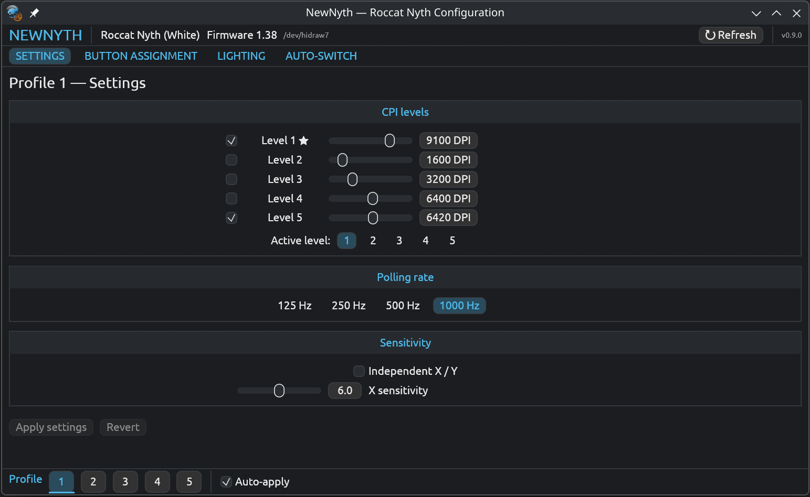
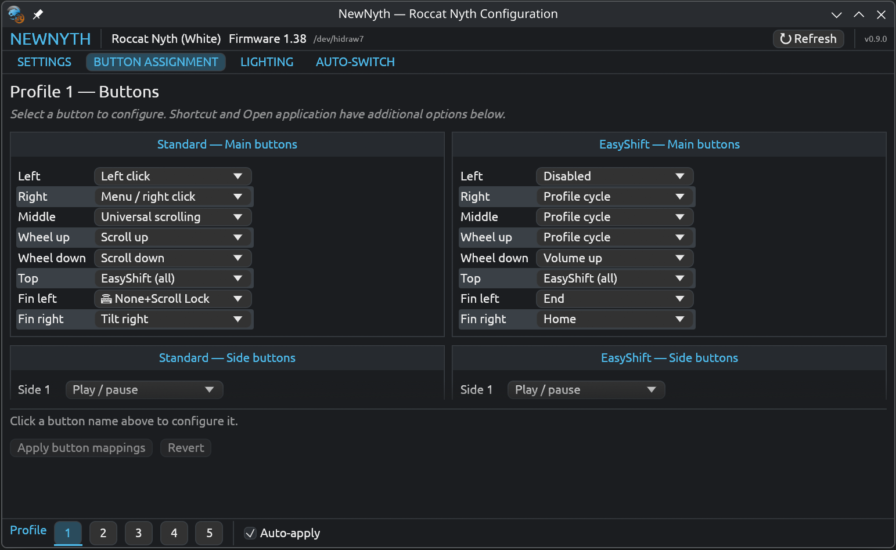
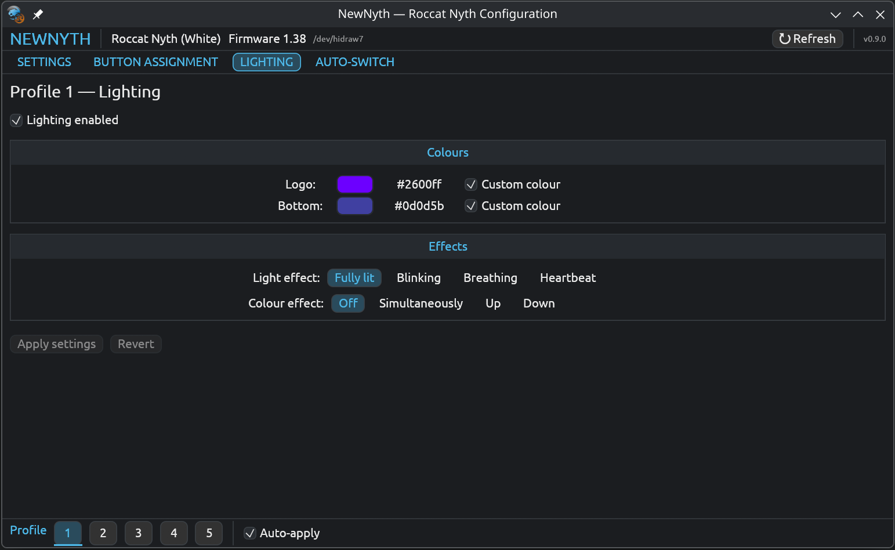
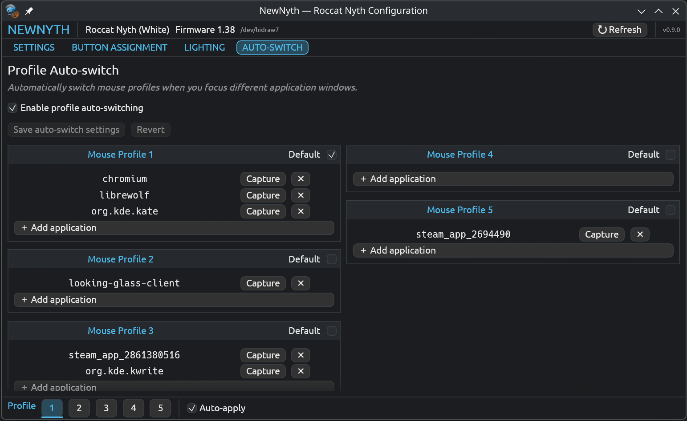
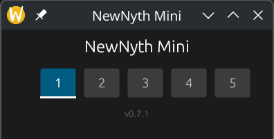

# NewNyth

**Modern Linux driver and configuration tools for the Roccat Nyth gaming mouse**, rewritten in (everybody's favourite) Rust.

[](https://github.com/LunaBaloona/NewNyth/actions/workflows/build.yml)
[](LICENSE)

Ported from the original [roccat-tools](https://sourceforge.net/projects/roccat/) C codebase (v5.9.1, GPL-2.0+) by Stefan Achatz. For this project, only the Nyth-specific code has been carried forward, and all other device support has been omitted. See [NOTICE](NOTICE) for attribution details.

## Why NewNyth when there's roccat-tools? 
I grew up with the Roccat Nyth and though I've tried alternatives over the years, NOTHING compares to this mouse (esp the handy fin switch and 3D printable side-buttons). I've even replaced the long-over-used switches just to keep this thing working. 

So, when I moved over to Linux a few years ago, I lamented the loss of several features, like the auto-profile-switching. The roccat-tools were a life-saver for a while, but as they were built on an older stack, there began to be compatibility issues with modern Linux DEs. And so the journey began to try move things to a new GUI and Rust code (which I was learning at that time). I mainly did this for my own use, since Roccat is no more and I don't think a lot of people still use this mouse. But I decided to clean things up and release it here for all. 

Note that because I started this for my own use, it's built for use on KDE and Wayland in Arch (mandatory "I use Arch BTW" 😉). It doesn't officially support Gnome or other DEs, nor distros. Although I don't think there's much that would prevent it working on those (other than the install method and profile auto-switch) but if there're enough requests (and I have the time) I'll be happy to adapt it. 


## Features

- **Full device control:** CPI levels, polling rate, sensitivity, lighting effects and colours, button remapping, and profile switching on all 5 profiles.
- **Configuration GUI** (`newnyth`): egui-based desktop app with 5 tabs: Settings, Lighting, Buttons, Auto-switch, Advanced
- **Profile auto-switch:** Automatically switches the mouse profile when you focus different application windows (in KDE Plasma, on Wayland)
- **Mini switcher** (`newnyth-mini`):  a small floating window with quick profile switch buttons. Useful if you don't have KDE or Wayland or just want to manually switch profiles. 
- **Background daemon** (`nythd`): Reads hardware events, handles media keys, launches applications from button presses, emits D-Bus signals.
- **CLI tool** (`nythctl`): device status, profile switching and driver-mode control for scripts and automations. Writing settings (CPI, lighting, buttons) is GUI-only for now.
- **Systemd user service**: Starts automatically on login

## Supported hardware:

| Variant | USB ID |
|---------|--------|
| Roccat Nyth Black | `1e7d:2e7c` |
| Roccat Nyth White | `1e7d:2e7d` |

## Screenshots

**Settings panel** - CPI levels, polling rate, and sensitivity.




**Buttons panel** - Map your buttons to various keys and functions.




**Lighting panel** - Colours, light effects and colour effects for both light zones.




**Profile Auto-switch panel** - Control how we switch profiles depending on the application you're on.




**NewNyth Mini** - A companion app that simply lets you select a profile. 




## Installation

Pick whatever matches your distro - everything ships the same four programs
and sets up the udev rule, `roccat` group, systemd user service and launcher
entries. The `.deb` and `.rpm` are built for Debian/Ubuntu and
Fedora/RHEL/openSUSE respectively; the one environment that is maintained
and tested end-to-end is Arch Linux with KDE Plasma on Wayland, so other
distros are expected to work but count as best-effort - please report
anything odd you hit there.

### Prebuilt binaries (any x86_64 distro with glibc ≥ 2.39)

Grab the asset for your distro from the
[latest release](https://github.com/LunaBaloona/NewNyth/releases/latest), or
download the tarball and run its installer:

```bash
# Debian / Ubuntu (Debian 13+, Ubuntu 24.04+)
sudo apt install ./newnyth_*_amd64.deb

# Fedora / RHEL / openSUSE
sudo dnf install ./newnyth-*.x86_64.rpm

# Anything else x86_64: self-contained tarball
tar xzf newnyth-*-x86_64-linux.tar.gz
cd newnyth-*-x86_64-linux
./install-prebuilt.sh
```

Then, whichever route you used:

```bash
# A desktop (logind-managed) session already gets device access through
# the udev rule's uaccess tag. Only a raw TTY or SSH session needs the
# roccat group as well:
sudo usermod -aG roccat $USER   # optional; log out and back in if used
systemctl --user enable --now nythd
newnyth
```

### Package repositories (apt / dnf)

Debian/Ubuntu and Fedora/RHEL/openSUSE machines can track releases with
the system package manager; updates then arrive through the usual
`apt upgrade` / `dnf upgrade`. The repositories are served from
[GitHub Pages](https://lunabaloona.github.io/NewNyth/) and their
metadata is GPG-signed:

```bash
# Debian / Ubuntu (Debian 13+, Ubuntu 24.04+)
sudo curl -fsSL https://lunabaloona.github.io/NewNyth/newnyth.gpg -o /usr/share/keyrings/newnyth.gpg
echo "deb [signed-by=/usr/share/keyrings/newnyth.gpg] https://lunabaloona.github.io/NewNyth/apt stable main" |
  sudo tee /etc/apt/sources.list.d/newnyth.list
sudo apt update && sudo apt install newnyth

# Fedora / RHEL / openSUSE
sudo curl -fsSL https://lunabaloona.github.io/NewNyth/dnf/newnyth.repo -o /etc/yum.repos.d/newnyth.repo
sudo dnf install newnyth
```

Then run the same follow-up steps as above.

### Arch Linux

#### First, the Prerequisites

```bash
# Build tools
sudo pacman -S rust base-devel

# GUI dependencies (egui  needs OpenGL & windowing)
sudo pacman -S libxkbcommon wayland libx11 mesa fontconfig

# D-Bus (for the daemon)
sudo pacman -S dbus

# Desktop notifications and folder buttons
sudo pacman -S libnotify xdg-user-dirs xdg-utils

# For media key support (Play/pause, volume, etc.)
sudo pacman -S playerctl

# Device permissions group (desktop logins get access via uaccess;
# the group is the fallback for TTY/SSH sessions)
sudo groupadd -f roccat
sudo usermod -aG roccat $USER   # optional; log out and back in if used
```

#### Next, build and install

```bash
git clone https://github.com/LunaBaloona/NewNyth.git
cd NewNyth
makepkg -si
```

Alternative manual install is also included (for those without Arch or prefer no `pacman` package tracking):

```bash
./install.sh
```

To remove everything that script installed again, run `./install.sh --uninstall`
(user config in `~/.config/newnyth` and the `roccat` group are left in place).
For a complete cleanup, `./install.sh --fulluninstall` (short: `-fu`) also
deletes that config directory and removes the `roccat` group and your
membership in it.

#### After installation

```bash
# Start the background daemon (already done for you by ./install.sh)
systemctl --user enable --now nythd

# Launch the main GUI
newnyth

# Or the mini-Gui, which is just a profile switcher
newnyth-mini
```

### Staying up to date

| Channel | Update with |
|---------|-------------|
| `.deb` | download the new release's `.deb`, then `sudo apt install ./newnyth_*_amd64.deb` |
| `.rpm` | download the new release's `.rpm`, then `sudo dnf upgrade ./newnyth-*.x86_64.rpm` |
| apt repo | `sudo apt update && sudo apt upgrade newnyth` |
| dnf repo | `sudo dnf upgrade newnyth` |
| tarball | download + re-run `./install-prebuilt.sh` |
| Arch `makepkg` | `git pull` in the checkout, then `makepkg -si` |
| `install.sh` | `git pull`, then `./install.sh` again |

> Everything is distributed from this repository's
> [Releases page](https://github.com/LunaBaloona/NewNyth/releases). The
> [apt and dnf repositories](#package-repositories-apt--dnf) mirror every
> published release, so those two channels upgrade in place; there is no
> AUR package, so the Arch channels update by rebuilding from the checkout.
> If a different package channel would help you, say so in the
> [issue tracker](https://github.com/LunaBaloona/NewNyth/issues).

## Components

| Binary | Purpose |
|--------|---------|
| `nythd` | Background daemon that reads hardware events and exposes D-Bus interface |
| `newnyth` | Full configuration GUI |
| `newnyth-mini` | Minimal floating window for quick profile switching |
| `nythctl` | A CLI for scripts and automation |

### `newnyth` - configuration GUI

**Settings panel** - CPI levels 1–5 (200–12,000 DPI, with individual enable toggles and active-level selector), polling rates (125/250/500/1000 Hz), and of course sensitivity (with optional independent X/Y axes).

**Lighting panel** - On/Off toggle, custom colour pickers for both light zones (logo and bottom), light effects (fully lit, blinking, breathing, heartbeat) with speed control, and colour effects (off, simultaneously, up, down). Everything on this panel is written straight to the device and stays with the profile; the Nyth offers exactly this fixed set of effects, not arbitrary animation, so the panel has no more to give. The colour-effect directions are the least-exercised corner: if one looks wrong on your unit, please report it. (But who uses RGB anymore)

**Buttons panel** - Remap all 40 buttons (20 standard + 20 EasyShift layer). Side-by-side columns for easy comparison, grouped by main buttons (left, right, middle, wheel up/down, top, fin left/right) and side buttons (Side 1–12 with separators every 4 buttons). Select a button to configure:

- **Shortcut** - Modifier checkboxes (Ctrl/Shift/Alt/Win) + 90+ HID keycodes including extended function keys F13–F24, numpad, arrows, system keys
- **Open application** - Launch any command when the button is pressed (now stored in `~/.config/newnyth/openers.json`)
- Plus 40+ built-in actions: scrolling, media keys, profile cycling, CPI up/down, EasyShift, EasyAim, and more

**Auto-switch panel** - Yes, just like Swarm used to do on MS Windows. With NewNyth can configure up to 10 application bindings per profile. Click "Capture window" and then click any application window - its class name is automatically captured. When auto-switch is enabled, the mouse profile changes automatically as you focus different windows. Optional default profile used when no bound app is active. (Requires KDE Plasma on Wayland: the tracker drives KWin's scripting API, so other compositors and X11 are not supported. Outside KDE use the Mini switcher to change profiles by hand.)

### `nythd` - event daemon

The daemon:
- Reads raw hidraw events from all Nyth interfaces
- Sends desktop notifications for profile / CPI / sensitivity changes
- Emits D-Bus signals on `org.roccat.Nyth` for the GUI
- Handles media key button presses via `playerctl` and `pactl`
- Launches applications configured in the Buttons panel
- Opens XDG folders (Documents, Pictures, etc.) for folder-open button presses
- Loads a KWin JavaScript watcher for auto-switch (KDE Plasma Wayland)
- Auto-retries KWin script loading every 5 seconds during login

Check status with:

```bash
systemctl --user status nythd
journalctl --user -u nythd -f
```

### `nythctl` - CLI

```bash
nythctl                     # Full device status overview
nythctl detect              # List connected devices
nythctl firmware            # Print firmware version
nythctl profile get         # Show active profile number
nythctl profile set 3       # Switch to profile 3
nythctl settings -p 2       # Show settings for profile 2
nythctl buttons -e          # Show button mappings (with EasyShift)
nythctl driver on/off       # Toggle driver-managed mode
nythctl reset [-y]          # Factory reset
nythctl --version           # Print version
```

### D-Bus interface

`nythd` exposes `org.roccat.Nyth` on the session bus at `/org/roccat/Nyth`:

| Type | Name | Description |
|------|------|-------------|
| Signal | `ProfileChanged(byte)` | Emitted when the active profile changes |
| Method | `ProfileChangedOutside(byte)` | Notify daemon of external profile change |
| Method | `ConfigurationChangedOutside()` | Tell daemon to reload config files |
| Method | `OpenGui()` | Launch the NewNyth GUI |
| Method | `WindowActivated(string)` | Called by the KWin script when the active window changes |

Monitor signals:

```bash
dbus-monitor --session "interface='org.roccat.Nyth'"
```

The bus name `org.roccat.Nyth` is shared with the (unmaintained)
roccat-tools: if both are installed, whichever service starts first
keeps the name and the other runs without D-Bus. The name is kept
deliberately for compatibility with existing integrations. From 1.0
this interface, the command lines and the config files are frozen:
see [API stability](docs/API-STABILITY.md).

## Configuration files

All stored under `~/.config/newnyth/`:

| File | Purpose |
|------|---------|
| `openers.json` | Commands launched by "Open application" button presses |
| `autoswitch.json` | Profile auto-switch rules |
| `profile_names.json` | Display names for the five profiles (typed in the GUI) |
| `kwin_watcher.js` | KWin window tracker script (auto-generated) |
| `active_window.txt` | Current window class (written by daemon) |

Each `.json` file carries a `version` field (currently `1`); a file that
fails to parse is copied to `<name>.bak` before NewNyth replaces it. The
formats are part of the 1.0 stability promise
([API stability](docs/API-STABILITY.md)).

## Architecture

```
NewNyth/
├── Cargo.toml                     # Workspace root
├── PKGBUILD                       # Arch Linux package
├── install.sh                     # Manual install/uninstall script (builds from source)
├── LICENSE                        # GPL-2.0
├── NOTICE                         # Attribution
├── README.md
├── assets/
│   └── newnyth.png                # Application icon
├── packaging/
│   ├── make-packages.sh           # Builds tarball + deb + rpm from a release build
│   ├── debian/                    # deb control + maintainer scripts
│   ├── rpm/newnyth.spec           # RPM spec (prebuilt-binary layout)
│   └── install-prebuilt.sh        # Installer shipped inside the release tarball
├── udev/
│   └── 70-roccat-nyth.rules       # Device permissions
├── systemd/
│   ├── nythd.service              # Systemd user service
│   └── roccat.sysusers            # roccat group definition
├── .github/
│   ├── workflows/build.yml        # CI pipeline
│   ├── workflows/release.yml      # Tag → GitHub Release (tarball + deb + rpm)
│   └── ISSUE_TEMPLATE/            # Bug report, feature request
└── crates/
    ├── roccat-nyth-hid/           # Low-level HID protocol and ioctl
    ├── roccat-nyth-profile/       # High-level device API + config files
    ├── nythctl/                   # CLI
    ├── nythd/                     # Event daemon
    ├── nyth-config/               # Main GUI (binary: newnyth)
    └── nyth-mini/                 # Mini GUI (binary: newnyth-mini)
```

## Development

### Building from source

```bash
git clone https://github.com/LunaBaloona/NewNyth.git
cd NewNyth

# Build all crates
cargo build --release

# Run tests
cargo test

# Run clippy lints
cargo clippy

# Format code
cargo fmt --all
```

The binaries will be at `target/release/`. Minimum Rust version: **1.95** (required by `eframe 0.37`).

### Contributing

See [CONTRIBUTING.md](CONTRIBUTING.md) for the full dev setup, the exact
gates CI runs and how to report hardware issues usefully. Short version:
run `cargo fmt --all` before committing, make sure `cargo test` and
`cargo clippy` pass, and open an issue first for large changes so we can
go over the approach.

## Known limitations

An honest list of what NewNyth does not do yet, so nothing below comes as
a surprise:

- **"Open application" commands are split on whitespace.** Quoted
  arguments (a path with a space in it, say) do not survive yet.
  Workaround: point the button at a small wrapper script.
- **Macro and button-set data is preserved, not edited.** Those device
  blobs are read and rewritten untouched when profiles change, but there
  is no macro editor in the GUI.
- **Timer and document buttons are ignored.** The mouse's timer
  start/stop and document keys are decoded by the daemon and logged,
  but nothing acts on them yet.
- **Auto-switch is KDE Plasma (KWin) only**, by design (see the
  Auto-switch panel above). Elsewhere, use the Mini switcher.
- **`nythctl` is read-and-switch only**: it can show status and switch
  profiles, not write CPI/lighting/button changes.

If one of these blocks you, say so in the
[issue tracker](https://github.com/LunaBaloona/NewNyth/issues).

## Troubleshooting

### No device found

```bash
# Check the mouse is enumerated
lsusb | grep 1e7d

# Check udev rules are actually loaded
ls -la /dev/hidraw*
# Files should be owned by root:roccat

# A desktop (logind) session gets access through the rule's uaccess
# tag; the node's ACL should list your user:
getfacl /dev/hidraw*

# From a TTY or over SSH you need the roccat group instead. Check and,
# if missing, add yourself (log out and back in afterwards):
groups $USER | grep roccat
sudo usermod -aG roccat $USER
```

### Do not run roccat-tools alongside NewNyth

NewNyth shares the D-Bus name `org.roccat.Nyth` with the unmaintained
roccat-tools: if both are installed, whichever daemon starts first keeps
the name and the other runs without D-Bus. Worse, roccat-tools' own
utilities do not respect NewNyth's device lock and can interrupt a write
mid-flight. Remove roccat-tools before installing NewNyth; everything the
Nyth needs is here.

### Auto-switch not working

Check the daemon detected KWin:

```bash
journalctl --user -u nythd | grep -i "kwin\|window"
```

You should see `Loaded KWin watcher script` and `KWin watcher script started`. If you see repeated retry messages, KWin D-Bus isn't available yet - wait a few seconds after login.

### Media keys do nothing

Install `playerctl`:

```bash
# Arch
sudo pacman -S playerctl

# Debian / Ubuntu
sudo apt install playerctl

# Fedora
sudo dnf install playerctl
```

Check the daemon receives the event when you press a media button:

```bash
journalctl --user -u nythd -f
# Press the button - you should see "Media: Play/Pause" or similar
```

## Licence

GPL-2.0-or-later, matching the original `roccat-tools` licence. See [LICENSE](LICENSE) and [NOTICE](NOTICE).

## Acknowledgements

- **Stefan Achatz** - original author of [`roccat-tools`](https://sourceforge.net/projects/roccat/), without which this port would not exist
- **The egui project** - for an excellent immediate-mode GUI framework
- **KDE Plasma team** - for KWin's scripting API which makes window tracking possible on Wayland
